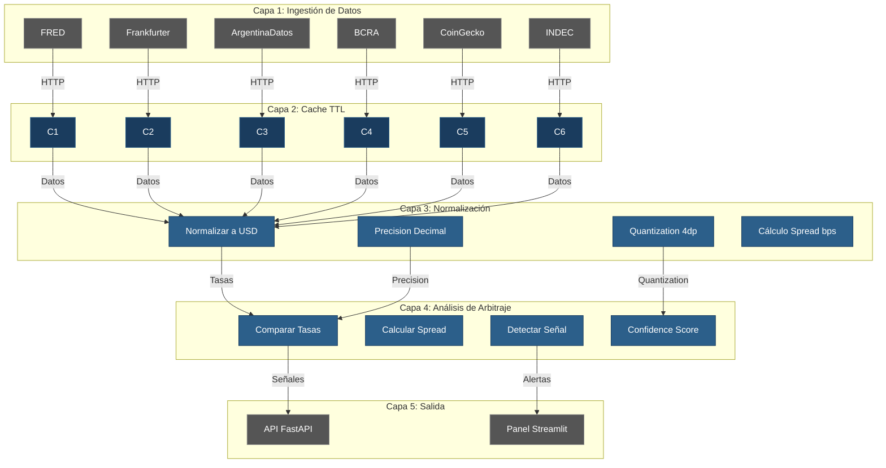

# Cross-Border FX & Treasury Risk Engine

## Project Overview

A multi-currency treasury pipeline integrating 6 real data sources (FRED, ECB/FX, ArgentinaDatos, BCRA, CoinGecko, INDEC) to track real-time FX exposure, detect arbitrage opportunities, and protect margins for global companies operating in volatile markets like Latin America.

Built as a Data Engineer exercise demonstrating:
- Financial precision with `decimal.Decimal`
- Multi-source data ingestion and normalization
- Arbitrage detection across FX rates
- Inflation-adjusted exposure tracking
- REST API + Streamlit dashboard

## Key Features

| Feature | Description |
|---------|-------------|
| **5+ Data Sources** | FRED (US Fed rates), Frankfurter (ECB FX), ArgentinaDatos/BCRA (local FX), CoinGecko (stablecoins), INDEC (CPI inflation) |
| **Decimal Precision** | Throughout all calculations — no float drift |
| **Arbitrage Engine** | Spread detection in basis points (bps) with threshold-based signals |
| **Inflation Adjustment** | Fisher equation with INDEC CPI data |
| **Multi-currency Support** | USD, EUR, BRL, MXN, ARS, USDT, USDC |
| **Real-time Dashboard** | Streamlit interface with metrics, tables, and alerts |
| **REST API** | FastAPI endpoints for all analysis functionality |

## Architecture

The system follows a 5-layer modular pipeline:

1. **Data Ingestion Layer** — 6 specialized adapters with consistent `Rate` model
2. **Cache Layer** — Source-specific TTL (CoinGecko: 60s, FRED: 3600s, INDEC: 86400s)
3. **Normalization Layer** — Rates converted to USD base, spread calculations in bps
4. **Analysis Layer** — Arbitrage detection, exposure tracking, margin-at-risk calculations
5. **Output Layer** — FastAPI + Streamlit dashboard



## Project Structure

```
ING.datos/
├── .gitignore              # Python/Cache ignores
├── cli.py                  # CLI: analyze / serve-api / serve-dashboard / health
├── generate_pdf.py         # Markdown → PDF generator (reportlab)
├── pyproject.toml          # Dependencies & config (poetry/pdm)
├── config/
│   └── engine.yaml         # Environment-aware source configuration
├── plans/
│   └── 1795252089936-cross-border-fx-treasury-engine-plan.md  # Technical plan
├── interview/
│   └── interview_qa.pdf    # Q&A PDF for IT interview
├── src/
│   ├── models/             # Rate, Spread, Exposure, ArbitrageSignal
│   ├── adapters/           # 6 API adapters (FRED, Frankfurter, ArgentinaDatos, BCRA, CoinGecko, INDEC)
│   ├── core/               # Engine orchestrator, normalization, arbitrage
│   ├── cache/              # TTL-based caching layer
│   ├── api/                # FastAPI endpoints + health checks
│   └── dashboard/          # Streamlit dashboard
├── tests/
│   └── test_models.py      # 23 unit tests - ALL PASSING
└── README.md              # This documentation
```

## Quick Start

```bash
# Run full analysis
python cli.py analyze

# Start FastAPI server
python cli.py serve-api    # http://0.0.0.0:8000

# Start Streamlit dashboard
python cli.py serve-dashboard  # http://0.0.0.0:8501

# Run tests
python -m pytest tests/ -v  # 23 passed
```

## Technical Deep Dive

### Data Sources

| Source | API | Frequency | Key Data |
|--------|-----|-----------|----------|
| **FRED** | Federal Reserve St. Louis | Daily | Fed Funds Rate, CPI, Treasury Yields |
| **Frankfurter** | ECB Exchange Rates | Daily | EUR, USD, BRL, MXN official rates |
| **ArgentinaDatos** | BCRA APIs | Daily/Hourly | Blue/official/financial dollar rates |
| **CoinGecko** | Public API | Real-time | USDT/USDC peg, market cap, liquidity |
| **INDEC** | Datos Argentina | Monthly | IPC CPI, IPM wholesale, real wages |

### Arbitrage Logic

```
Spread (bps) = |(RateA - RateB) / RateA| × 10,000
If spread > threshold (default: 50 bps) → signal generated
Direction: BUY at cheaper rate, SELL at more expensive
Expected savings = $1M × spread_bps / 10,000 × 0.01
```

### Inflation Adjustment

Real return = (1 + Nominal) / (1 + Inflation) - 1

Monthly adjustment: `adjusted = nominal × (1 - inflation_rate)^months`

### Interview Pitch (30 seconds)

> *"I built a multi-currency treasury pipeline integrating Fed rates, ECB FX data, and emerging-market central bank APIs to track real-time FX exposure and inflation erosion—helping global finance teams protect margins and optimize cross-border liquidity."*

## License

MIT — free for commercial and non-commercial use.